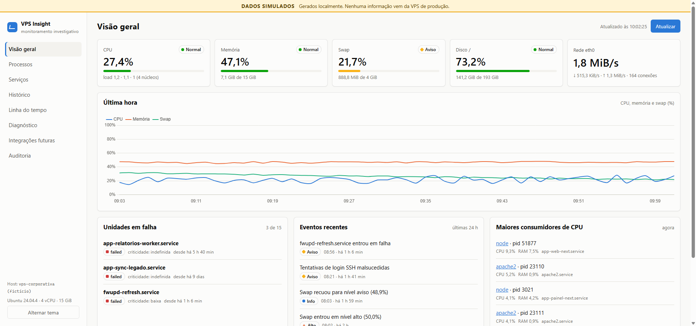
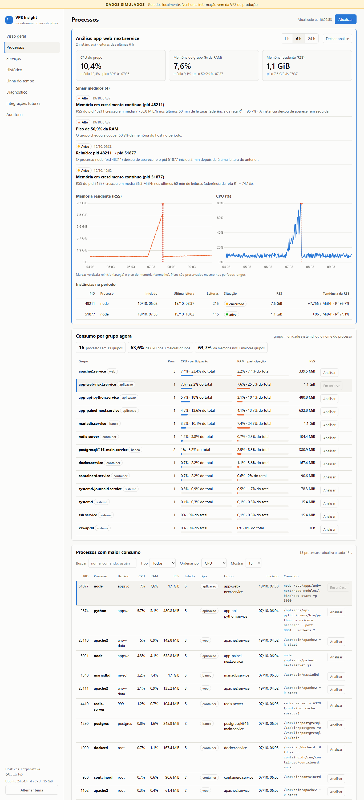
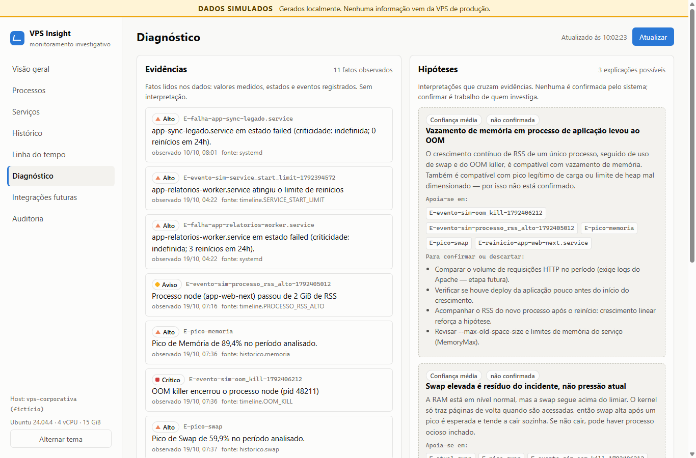
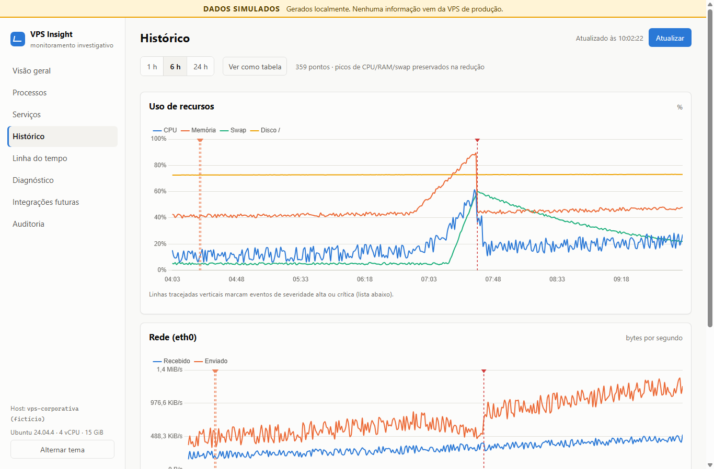
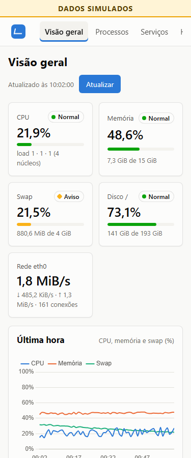

# VPS Insight

Dashboard de **monitoramento investigativo** para uma VPS corporativa de produção.
Ele mostra CPU, memória, swap, disco e rede, os processos que mais consomem
(com análise ao longo do tempo), os serviços systemd, o histórico, uma linha do
tempo de eventos e um diagnóstico que separa **evidências** (fatos medidos) de
**hipóteses** (interpretações).

> [!IMPORTANT]
> **Esta versão usa exclusivamente DADOS SIMULADOS.** Nenhuma parte do código
> acessa a VPS, abre SSH, executa comandos, consulta bancos ou instala agente.
> Toda resposta da API e toda tela trazem a marca `SIMULADO`. As garantias estão
> descritas em [docs/SEGURANCA.md](docs/SEGURANCA.md) e são verificadas por testes.



## Sumário

- [Estado do projeto](#estado-do-projeto)
- [Regras do projeto](#regras-do-projeto)
- [Telas](#telas)
- [O cenário simulado](#o-cenário-simulado)
- [Como executar](#como-executar)
- [API](#api)
- [Arquitetura](#arquitetura)
- [Segurança](#segurança)
- [Qualidade: validação e testes](#qualidade-validação-e-testes)
- [Histórico do que foi feito](#histórico-do-que-foi-feito)
- [Pendências](#pendências)

---

## Estado do projeto

| Área | Situação |
|---|---|
| Dashboard (8 telas, celular a monitor grande, tema claro/escuro) | ✅ pronto, com dados simulados |
| Análise de processos de maior consumo | ✅ pronto |
| Diagnóstico evidência × hipótese | ✅ pronto |
| Histórico em SQLite com migrações versionadas | ✅ pronto |
| Segurança (só leitura, só loopback, auditoria, erros padronizados) | ✅ pronto |
| Validação automática (lint, tipos, 264 testes, smoke, telas em 6 larguras) | ✅ pronto |
| Coleta real na VPS | ⛔ bloqueada no código, aguarda decisão e aprovação |
| Integrações com logs HTTP, Docker e bancos | 📐 só o contrato de dados (modelos e interfaces) |

**Stack:** Python 3.12+, FastAPI, Pydantic, SQLite, HTML/CSS/JavaScript (módulos ES,
sem build), Chart.js 4.4.1 (incluído no repositório) e pytest. Ferramentas de
desenvolvimento: ruff, mypy, Node e Chrome/Edge headless para validar as telas.

## Regras do projeto

| Arquivo | Conteúdo |
|---|---|
| [CLAUDE.md](CLAUDE.md) | **Regra acima de todas: não interferir na VPS de produção.** Proíbe acessar, executar comandos, instalar, alterar serviços ou configurações, conectar nos bancos ou no Docker, gerar carga e publicar o dashboard. Qualquer passo que toque a VPS exige aprovação explícita para aquela ação específica. |
| [MASTER_PROMPT.md](MASTER_PROMPT.md) | Constituição técnica: arquitetura, banco, segurança, responsividade, testes, documentação e definição de pronto. |
| [AGENTS.md](AGENTS.md) | Aponta os dois arquivos acima para outros agentes de IA. |

## Telas

| Tela | O que mostra |
|---|---|
| **Visão geral** | CPU, RAM, swap, disco e rede com nível (normal, aviso, alto, crítico), gráfico da última hora, unidades em falha, eventos recentes e maiores consumidores. Atualiza a cada 15 s. |
| **Processos** | Consumo por grupo (unidade systemd, ou nome do processo) com a participação de cada um na CPU e na RAM; lista com busca e filtros; **análise de um grupo**: CPU e memória em 1, 6 ou 24 h, instâncias (PIDs) e sinais medidos (memória em crescimento contínuo, reinício, CPU sustentada, pico). |
| **Serviços** | Inventário das unidades systemd com estado e criticidade. As aplicações corporativas ficam como `indefinida` até haver acordo com os responsáveis. |
| **Histórico** | Séries de 1, 6 ou 24 h com eventos altos e críticos marcados no gráfico; alterna para tabela. |
| **Linha do tempo** | Eventos de serviço, processo, métrica, sistema e segurança, com filtros. |
| **Diagnóstico** | Evidências à esquerda e hipóteses à direita. Cada hipótese aponta as evidências em que se apoia (clique para destacar) e traz como confirmar ou descartar. |
| **Integrações futuras** | Contratos previstos para logs HTTP, Docker e bancos, com as salvaguardas de cada um. |
| **Auditoria** | Trilha de consultas, bloqueios e ciclo de vida, com `request_id` e paginação. |

<details>
<summary><b>Mais capturas</b> (análise de processos, diagnóstico, histórico, celular)</summary>

**Análise de processos** (grupo `app-web-next.service`, 6 h)



**Diagnóstico**



**Histórico**



**Celular (375 px)**



</details>

## O cenário simulado

Os dados contam uma história que dá para investigar, posicionada em relação ao
momento em que o servidor sobe (4 vCPU, 15 GiB, Ubuntu 24.04, Apache, Docker,
MariaDB, PostgreSQL 16 e apps Next.js e Python):

1. **~5h40 antes:** `app-relatorios-worker.service` falha e esgota os reinícios.
2. **~3h10 antes:** o processo Next.js de `app-web-next` começa a vazar memória.
   A RAM chega a ~96%, a swap passa a ser usada e a CPU sobe.
3. **~2h25 antes:** o kernel encerra o `node` por falta de memória (OOM killer), e o systemd o reinicia com outro PID.
4. **Agora:** a RAM está normal, mas a swap segue em aviso e o processo novo **voltou a crescer**.

Há ainda uma unidade em falha há 9 dias (`app-sync-legado`), uma falha
irrelevante de `fwupd-refresh` e tentativas de login SSH malsucedidas.
**Os nomes das aplicações corporativas são fictícios.** A simulação é
determinística (mesma semente e mesmo instante produzem o mesmo valor) e é
recriada a cada inicialização.

## Como executar

**Requisitos:** Python 3.12 ou superior (validado em 3.14) e um navegador moderno.
Para o ciclo completo de validação, também Node e Chrome ou Edge.

**Windows (PowerShell):**

```powershell
.\rodar.ps1            # cria o .venv, instala dependências e sobe o servidor
.\rodar.ps1 -Testes    # só os testes
.\rodar.ps1 -Verificar # ciclo completo: formatação, lint, tipos, testes, smoke e telas
```

**Linux/macOS:**

```sh
./rodar.sh             # sobe o servidor
./rodar.sh testes      # só os testes
./rodar.sh verificar   # ciclo completo
```

**Manual:**

```sh
python -m venv .venv
.venv/bin/pip install -r requirements-dev.txt      # Windows: .venv\Scripts\pip
.venv/bin/python -m app.main
```

Abra **http://127.0.0.1:8765**. A documentação interativa da API fica em `/docs`.
O servidor só existe enquanto o terminal estiver aberto (Ctrl+C encerra): não há
serviço, agendamento nem inicialização automática.

### Configuração (opcional, variáveis de ambiente)

| Variável | Padrão | Observação |
|---|---|---|
| `VPS_INSIGHT_PORTA` | `8765` | 1024–65535 |
| `VPS_INSIGHT_HOST` | `127.0.0.1` | só aceita loopback (`127.0.0.1`, `localhost`, `::1`) |
| `VPS_INSIGHT_DB` | `data/vps_insight.sqlite3` | arquivo SQLite local |
| `VPS_INSIGHT_SEMENTE` | `42` | muda o ruído da simulação |
| `VPS_INSIGHT_AMOSTRAGEM_S` | `15` | amostra simulada "ao vivo"; `0` desliga |
| `VPS_INSIGHT_MODO` | `simulado` | qualquer outro valor é recusado |

Um valor inválido impede o servidor de subir, com uma mensagem que diz qual
variável corrigir.

## API

Somente leitura (`GET`). Toda resposta vem no formato
`{"origem": "SIMULADO", "aviso": "...", "gerado_em": "...", "dados": ...}`.

| Endpoint | Retorna |
|---|---|
| `GET /api/health` | estado, versão, modo e versão do banco |
| `GET /api/metrics/current` | leitura atual + nível de cada métrica + limiares |
| `GET /api/metrics/history?horas=6&max_pontos=360` | série histórica (picos preservados na redução) |
| `GET /api/processes?ordenar_por=cpu&limite=15&busca=&categoria=` | maiores consumidores, com o `grupo` de cada um |
| `GET /api/processes/summary` | consumo por grupo, participação e concentração nos 3 maiores |
| `GET /api/processes/analysis?grupo=...&horas=6` | série, estatísticas, instâncias e sinais do grupo |
| `GET /api/services?estado=&criticidade=` | inventário systemd com contagens |
| `GET /api/events?horas=24&tipo=&severidade=` | linha do tempo |
| `GET /api/diagnostics?horas=24` | evidências e hipóteses |
| `GET /api/integrations` | integrações planejadas |
| `GET /api/audit?limite=100&categoria=&antes_id=` | trilha de auditoria (paginação por cursor) |

**Erros** saem sempre no mesmo formato, sem stack trace:
`{"erro": {"codigo", "mensagem", "detalhes"?, "request_id"}}`. O `request_id` também
vem no cabeçalho `X-Request-ID` e aparece no log e na auditoria.

## Arquitetura

```
 Navegador (HTML/CSS/JS + Chart.js local)
        │  GET /api/*
        ▼
 security/middleware  ── loopback? GET? → request_id, cabeçalhos CSP, auditoria, erro 500 seguro
        ▼
 api/routes/*         rotas finas: validam parâmetros e embrulham no envelope
        ▼
 monitor.py           camada de aplicação: decide a fonte e aplica o domínio
        │                        │                          │
 collectors/                 domain/ (regras puras)      storage/ (SQLite + migrações)
   base.py   interfaces        thresholds   limiares        metricas, eventos, auditoria
   simulated ← em uso          criticality  criticidade     processos, processos_amostras
   future    ← bloqueado       timeline     transições
   registry                    diagnostics  evidência → hipótese
                               processes    consumo, tendência, sinais
```

- **Coletores** atrás de interfaces: trocar o simulado pelo real não muda domínio, API nem telas.
- **Domínio** sem dependência de banco ou web, testado diretamente.
- **Fonte única** para cada regra: limiares, grupo de processo, disco principal e formatação pt-BR ficam cada um num só lugar.
- **Banco:** versão do esquema em `PRAGMA user_version`. Cada migração é imutável e
  roda numa transação: se falhar, nada muda e o app não sobe. O próprio banco
  recusa valores fora do domínio (CHECK), as chaves estrangeiras usam cascata e as
  consultas frequentes têm índice.
- **Frontend** sem build:
  - uma tela por módulo, com estados de carregamento, vazio e erro;
  - resposta atrasada de uma tela anterior nunca sobrescreve a atual;
  - se uma atualização falha, os últimos dados ficam na tela com um aviso;
  - o foco é preservado nas atualizações automáticas;
  - níveis aparecem sempre com forma e texto, nunca só com cor.

Detalhes, regras de cada sinal e como plugar a coleta real estão em
[docs/ARQUITETURA.md](docs/ARQUITETURA.md).

```
app/
  config.py  main.py  monitor.py  errors.py
  models/       contratos Pydantic (métricas, processos, serviços, eventos, diagnóstico, auditoria, integrações)
  collectors/   interfaces, simulador, esboços dos coletores reais
  domain/       regras de negócio
  storage/      SQLite, migrações e repositórios
  security/     regras e middleware
  audit/        trilha de auditoria
  api/          rotas e tradução de erros
  web/static/   index.html, css/, js/ (views/ por tela), vendor/chart.umd.min.js
scripts/        verificar.py (ciclo de validação), validar_telas.mjs (Chrome headless)
tests/          264 testes (pytest)
docs/           ARQUITETURA.md, SEGURANCA.md, img/
```

## Segurança

| Restrição | Como é garantida |
|---|---|
| Não acessar a VPS, nem por SSH | Nenhum módulo de rede, SSH ou processo no código (`subprocess`, `socket`, `paramiko`, `requests`…). Uma **varredura estática nos testes** falha se algum aparecer. |
| Não consultar bancos corporativos | Nenhum driver de banco; o único banco é o SQLite local (mesma varredura). |
| Não coletar dados reais | O modo só aceita `simulado`; os coletores reais lançam `ColetaRealDesabilitada`. |
| Não modificar nada | A API aceita apenas GET, HEAD e OPTIONS (o resto dá 405 e fica auditado). |
| Não expor à internet | Escuta só em loopback; o cabeçalho `Host` é validado (proteção contra DNS rebinding). |
| Dados claramente simulados | `origem: "SIMULADO"` em toda resposta, cabeçalho `X-Data-Origin`, faixa fixa na interface e apps marcadas como `[Fictício]`. |

Outras proteções:
- CSP restritiva (`default-src 'self'`, sem `unsafe-inline`), `X-Frame-Options: DENY` e `nosniff`.
- DOM montado só com `textContent`.
- SQL sempre parametrizado.
- Nenhuma requisição de saída.

Detalhes em [docs/SEGURANCA.md](docs/SEGURANCA.md).

## Qualidade: validação e testes

Um comando roda tudo, e nada é dado como pronto sem passar por ele:

```sh
python scripts/verificar.py              # tudo
python scripts/verificar.py --rapido     # sem servidor nem navegador
python scripts/verificar.py --capturas   # também salva screenshots das telas
```

| Etapa | Ferramenta | Falha quando |
|---|---|---|
| Formatação | `ruff format --check` | algum arquivo fora do padrão |
| Lint | `ruff check` (inclui regras de segurança `S` e de datas `DTZ`) | qualquer aviso |
| Tipos | `mypy` | qualquer erro |
| Sintaxe JS | `node --check` | erro de sintaxe |
| Testes | `pytest` | qualquer teste falhando |
| Smoke | servidor real em `127.0.0.1:8799` com banco temporário | endpoint ≠ 200, sem origem `SIMULADO`, acima de 1 s, ou erro fora do formato |
| Telas | Chrome/Edge headless: 9 telas × 320/375/768/1024/1366/1920 px | rolagem horizontal, cartão fora da tela, erro na tela, `console.error`, exceção ou violação de CSP |

Se faltar Node ou navegador, as duas últimas etapas aparecem como **puladas**, e
não como "ok". O validador não enxerga texto sobreposto dentro de gráficos; para
isso, use `--capturas` e confira as imagens.

**264 testes** (cerca de 26 s), cobrindo:
- **config:** modo real, host externo e porta privilegiada são recusados, inclusive via variável de ambiente;
- **coletores:** determinismo, faixas válidas, cenário do incidente e coletores reais bloqueados;
- **domínio:**
  - limiares, criticidade e eventos de transição;
  - hipótese sem evidência, ou já "confirmada", é rejeitada pelo modelo;
- **processos:**
  - agrupamento, busca, participação e regressão linear;
  - cada sinal com dados sintéticos, inclusive os casos que **não** devem disparar;
  - PID reaproveitado e o incidente de ponta a ponta;
- **API e erros:**
  - todos os endpoints, filtros e validação;
  - erro 500 sem stack trace e rastreável pelo `request_id`;
- **migrações:**
  - arquivo antigo migrado sem perder dados;
  - migração que falha não deixa o banco pela metade;
  - o banco recusa valores fora do domínio e as constraints acompanham os enums;
- **limites:** bordas de cada parâmetro, vazio, cursor além do fim, virada de ano, ano bissexto e fuso diferente de UTC;
- **encoding e pt-BR:**
  - João, Conceição, d'Ávila, R$ 1.234,56 e emoji em ida e volta no banco;
  - todos os arquivos em UTF-8 válido;
  - vírgula decimal nos textos;
- **robustez:**
  - 8 threads gravando em paralelo sem perder registro;
  - orçamento de desempenho com 10 dias de histórico;
- **regressão:** um teste por bug corrigido;
- **segurança:** 405, 400, cabeçalhos, auditoria e a varredura estática do código.

Para conferir que os testes detectam problemas de verdade, bugs foram inseridos de
propósito numa cópia do projeto (teste de mutação manual). Todos foram detectados.

## Histórico do que foi feito

### 1. MVP com dados simulados
- Estrutura modular: config, modelos, coletores, domínio, storage, segurança, auditoria, API e web.
- Simulador determinístico com o cenário de incidente; interfaces para os coletores futuros.
- Dashboard com 8 telas, responsivo, tema claro e escuro, faixa fixa "DADOS SIMULADOS".
- Diagnóstico com evidências e hipóteses separadas e garantidas pelo modelo.
- Proteções: modo só simulado, só loopback, API só leitura, cabeçalhos CSP e auditoria.

### 2. Regras do projeto
- `MASTER_PROMPT.md` (constituição técnica) e `CLAUDE.md`, com a regra de **não interferir na VPS**, que prevalece sobre tudo.

### 3. Boas práticas do MASTER_PROMPT aplicadas
- **Validação num comando** (`scripts/verificar.py`) e validação automática das telas em 6 larguras.
- **Erros padronizados** com `request_id`; falha interna vira 500 seguro, registrada no log e na auditoria.
- **Migrações versionadas** do SQLite, com o domínio garantido pelo próprio banco; paginação por cursor na auditoria.
- **Frontend robusto:**
  - estados de carregamento, vazio e erro;
  - proteção contra resposta atrasada de outra tela;
  - os últimos dados ficam na tela quando uma atualização falha.
- **Bugs encontrados na autorrevisão e corrigidos**, cada um com teste de regressão:
  - resposta atrasada de uma tela sobrescrevia outra;
  - a rota `#/constructor` quebrava a interface;
  - uma falha apagava a tela inteira;
  - o banco aceitava CPU de 150%;
  - texto com ponto decimal e com horário UTC misturado ao local;
  - "De" maiúsculo nas datas;
  - rótulos de gráfico sobrepostos no celular;
  - coluna da auditoria quebrando letra por letra;
  - regras duplicadas em vários lugares.

### 4. Análise de processos de maior consumo
- Consumo por grupo, com participação e concentração.
- Busca e filtros na lista de processos.
- Análise por grupo:
  - série de CPU e memória, estatísticas e instâncias;
  - sinais medidos: memória em crescimento contínuo (regressão linear em duas janelas), reinício, CPU sustentada e pico.
- Histórico de processos no banco (migração v3): instância (PID + início) e amostras, com chave estrangeira.
- **Desempenho:**
  - geração da simulação ~40% mais rápida (hash no lugar de `random.Random`);
  - a suíte de testes voltou de 175 s para 26 s (banco semeado uma vez por sessão).

## Pendências

**Dependem de decisão** (nada disso pode ser feito sem aprovação explícita, conforme o `CLAUDE.md`):
1. **Coleta real:** onde o coletor roda (na própria VPS, sem privilégio e sem SSH a partir do dashboard), com quais permissões, e como os dados chegam ao dashboard.
2. **Intervalo de coleta:** de 5 a 15 s gera carga desprezível, mas precisa ser acordado.
3. **Criticidade:** definir a criticidade de cada serviço corporativo com os responsáveis.

**Técnicas:**

4. **Retenção:** a auditoria e o histórico não têm regra de limpeza.
5. **Python 3.12:** só foi validado no 3.14, ainda não num 3.12 de verdade.
6. **Atualização ao vivo:** quando houver coleta real, usar Server-Sent Events; hoje as telas consultam o servidor a cada 15 s.
7. **Limiares:** revisar os de métricas e de processos com dados reais.
8. **Documentos:** os que o MASTER_PROMPT lista e ainda não foram criados (`PROJECT_CONTEXT.md`, `FUNCIONALIDADES.md`, `.env.example` etc.).

**Fora do escopo atual:** login e permissões (desnecessários enquanto só abre em
loopback), alertas e notificações, e publicar o dashboard para outras pessoas.
